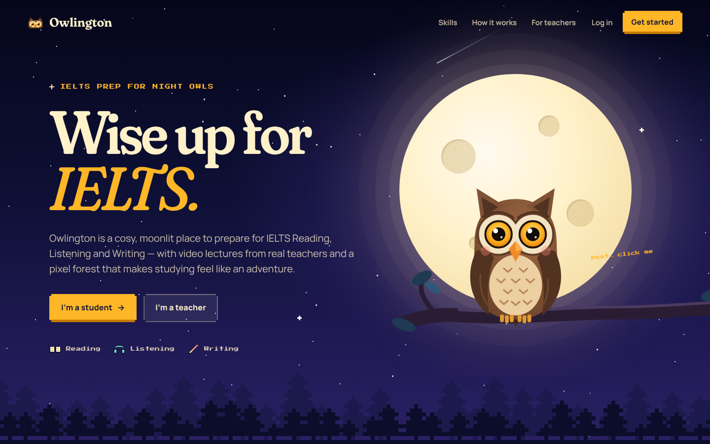
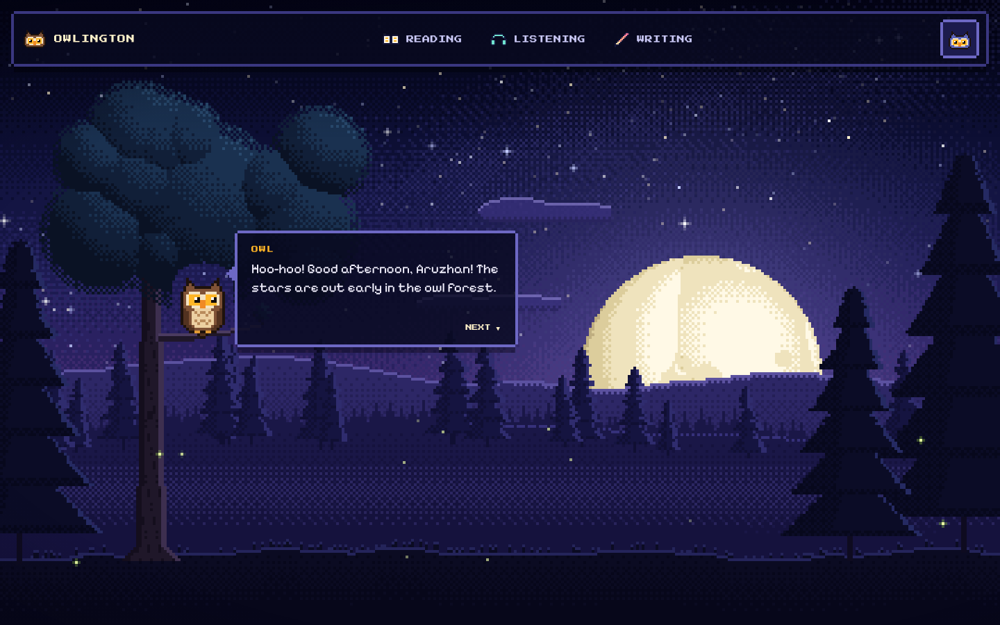
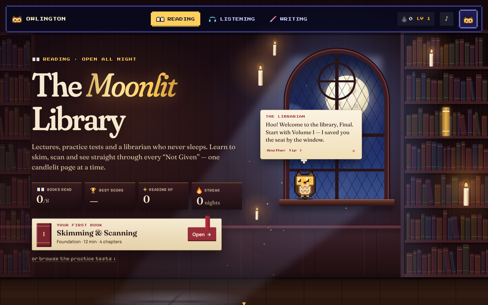
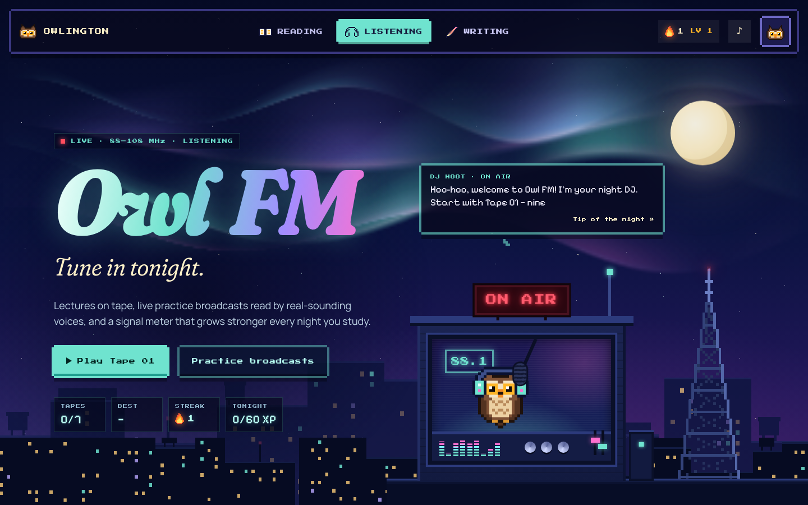
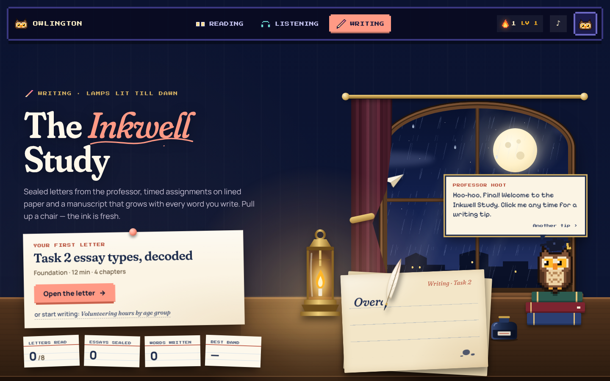

# 🦉 Owlington

**IELTS prep for night owls.** Owlington is a cosy, moonlit place to prepare for the three IELTS skills,
**Reading**, **Listening** and **Writing**, with video lectures from real teachers and a pixel-art forest that
makes studying feel like an adventure.



## What's built so far

| Area | Status |
| --- | --- |
| **Landing page**: night-sky hero, interactive owl mascot (eyes follow your cursor, it blinks and hoots when clicked), skill cards, how-it-works, student/teacher “doors” with a live preview of the student world | ✅ |
| **Sign up / log in**: choose **Student** or **Teacher** at registration; each role gets its own dashboard | ✅ (temporary, browser-only auth, see below) |
| **Student dashboard**: full-screen animated pixel night (see below) with a HUD on top: `READING` · `LISTENING` · `WRITING` tabs and the student's avatar on the right | ✅ |
| **Reading, Listening and Writing sections**: each its own animated world with video lectures, practice tests and progress tracking (see below) | ✅ (lectures play as animated notes until videos are uploaded) |
| **Progress & motivation**: XP, levels, daily streaks, achievements, score history, celebrations, 8-bit sounds | ✅ (stored in the browser for now) |
| **Student profile** (opened from the avatar) | 🟡 placeholder |
| **Teacher dashboard** | 🟡 placeholder |



### The pixel night

The student dashboard background is drawn live on a `<canvas>` at a low “virtual” resolution and scaled up with
`image-rendering: pixelated`, so every pixel is a crisp square. All of it is generated from a fixed seed in
[`src/scene/NightSceneEngine.ts`](src/scene/NightSceneEngine.ts):

- a big, deep sky full of **twinkling stars** and a dithered **Milky Way**
- **falling stars** streaking across every few seconds
- a **huge moon rising on the horizon** with craters, maria and a glowing halo
- layered hills, drifting clouds and valley mist
- **swaying pine trees** and a big moonlit oak that drops the odd leaf
- **the owl** perched on the oak's branch: it blinks, looks around, and hoots (with music notes) when you click it.
  On the dashboard it also talks to you in an RPG-style dialog box with IELTS tips.
- fireflies drifting over the meadow

It pauses when it's off-screen and respects `prefers-reduced-motion`.

## The three sections

All three share one goal — **video lectures → practice tests → progress you can see** — but each is its own world
with its own metaphor, layout and motion.

| | Concept | Lectures | Practice |
| --- | --- | --- | --- |
| **Reading** | *The Moonlit Library*: a candlelit library tower with moonbeams and drifting dust | 8 lectures as books on a shelf; a bookmark ribbon shows how far you've read | 4 original passages with 48 questions in the real exam layout (passage beside questions): True/False/Not Given, matching headings, completion tasks with word limits, highlighting, a candle timer, a question navigator, review with "show in passage" and a "second look" retry mode |
| **Listening** | *Owl FM*: a rooftop radio station under the aurora | 7 lectures as cassette tapes; the tape winds from reel to reel as you watch | 4 broadcasts (Parts 1–4, 39 questions) read aloud by the browser's speech voices with different accents (exam mode: plays once; practice mode: pause and replay), form/note completion, multiple choice and map labelling, with a transcript review that highlights answers and distractors |
| **Writing** | *The Inkwell Study*: a lantern-lit desk by a rainy window | 8 lectures as sealed letters pinned to a board | 6 prompts — Academic Task 1 (an original chart and a process), a General Training letter and three Task 2 essays — in a writing studio: ink-clock timer, live word goal, linking-word and sentence-rhythm panels, autosave, an automatic 10-point checklist, self-assessment on the four official criteria and annotated model answers |

<p>
  
  
  
</p>

### Lectures and videos

Lectures live in each section's `content.ts` (`src/pages/student/<section>/content.ts`). Until a teacher records the
video, the player shows an **animated notes preview**: the pixel owl presents every key point of every chapter like
slides, with a timeline, chapters, speed control and resume. To attach a real video, set `video` on the lecture:

```ts
video: { kind: 'file', src: '/videos/skimming.mp4', poster: '/videos/skimming.jpg' }
// or
video: { kind: 'youtube', id: 'VIDEO_ID' }
```

Progress tracking keeps working the same way for real videos.

### Progress & motivation

[`src/learn/`](src/learn) holds the shared learning layer every section uses:

- **XP and levels**: finishing a lecture gives 50 XP, and a practice test gives up to 80 XP depending on accuracy.
  Levels run from *Owlet* to *Legend of the Night*.
- **Daily streaks** (the flame in the top bar) and **achievements** (*First Light*, *Night Owl*, *Bookworm*,
  *Golden Ears*, *Inkslinger*…) that pop up with confetti and a chiptune.
- **Score history and best scores** per practice test, and **lecture progress** with resume.
- A **sound toggle** in the top bar for the 8-bit effects.

## Tech stack

- [React 19](https://react.dev) + [TypeScript](https://www.typescriptlang.org) + [Vite](https://vite.dev)
- [React Router](https://reactrouter.com) for pages and role-based route guards
- Plain CSS (one stylesheet per page/component) with design tokens in [`src/index.css`](src/index.css)
- Self-hosted fonts via Fontsource: **Fraunces** (display), **Manrope** (body), **Press Start 2P** and
  **Pixelify Sans** (pixel UI)
- No image assets: the owl mascot is hand-written SVG, and all pixel art is defined as text sprites in
  [`src/scene/sprites.ts`](src/scene/sprites.ts)

## Getting started

Requires **Node.js 20.19+** (or 22.12+).

```bash
npm install
npm run dev        # http://localhost:5173
```

| Script | What it does |
| --- | --- |
| `npm run dev` | Start the dev server with hot reload |
| `npm run build` | Type-check and build for production into `dist/` |
| `npm run preview` | Serve the production build locally |
| `npm run typecheck` | Type-check only |
| `npm run lint` | Lint with oxlint |

Try it: open the site → **Get started** → pick **Student** → you land in the forest. Click the owl!

## Project structure

```
src/
├── App.tsx                  # routes
├── index.css                # design tokens, buttons, pixel panels
├── auth/                    # AuthProvider, useAuth(), <RequireRole>, temporary mock API
├── learn/                   # shared learning layer: progress store + useProgress(), lecture player,
│                            #   progress widgets, achievement toasts, confetti, sound effects, ScrollLink
├── components/
│   ├── NightScene.tsx       # React wrapper around the canvas engine
│   ├── OwlMascot.tsx        # the vector owl from the landing page
│   ├── PixelSprite.tsx      # renders text sprites as crisp SVG
│   └── Avatar.tsx           # every student is an owlet
├── data/sections.ts         # Reading / Listening / Writing: copy, colours, real test format
├── scene/
│   ├── NightSceneEngine.ts  # the procedural, animated pixel night
│   ├── sprites.ts           # owl + icon pixel art
│   └── random.ts            # seeded RNG and value noise
└── pages/
    ├── landing/             # marketing page
    ├── auth/                # register (student/teacher) + login
    ├── student/             # layout + HUD, owl dialog, profile
    │   ├── reading/         # The Moonlit Library (content.ts, practice-data.ts, hub, lecture, practice)
    │   ├── listening/       # Owl FM (content.ts, practice-data.ts, speech.ts, hub, lecture, practice)
    │   └── writing/         # The Inkwell Study (content.ts, prompts.ts, analysis.ts, hub, lecture, studio)
    ├── teacher/             # teacher dashboard (placeholder)
    └── NotFound.tsx
```

### Routes

| Path | Who | Page |
| --- | --- | --- |
| `/` | everyone | Landing |
| `/register?role=student\|teacher` | everyone | Sign up |
| `/login` | everyone | Log in |
| `/student` | students | Dashboard (pixel night) |
| `/student/reading`, `/listening`, `/writing` | students | Section hub: lectures, practice tests, progress |
| `/student/<section>/lecture/:lectureId` | students | Lecture player |
| `/student/<section>/practice/:practiceId` | students | Practice test |
| `/student/profile` | students | Profile (placeholder) |
| `/teacher` | teachers | Teacher dashboard (placeholder) |

## ⚠️ About authentication (temporary)

There is **no backend yet**. Accounts are stored in the browser's `localStorage` by
[`src/auth/mockAuthApi.ts`](src/auth/mockAuthApi.ts) so the product can be clicked through end-to-end. This is
**not secure** and every browser has its own separate set of accounts. When the backend exists, replace the
functions in that one file with API calls. The rest of the app only talks to `AuthProvider`.

Learning progress works the same way: [`src/learn/progress.ts`](src/learn/progress.ts) keeps it in `localStorage`
per student, behind the `useProgress()` hook, so it can move to the backend later without touching the pages.

## Deploying

### GitHub Pages

The `Deploy to GitHub Pages` workflow builds and publishes changes pushed to `main`.
In repository **Settings → Pages → Build and deployment**, choose **GitHub Actions**
as the source. Run the workflow manually from **Actions** if it has not deployed yet.
The published address is `https://nurmukasan.github.io/owlington/`.

Pages builds use `GITHUB_PAGES=true npm run build`, setting the asset base to
`/owlington/` and using hash routes so refreshing a page works on static hosting.
Regular local development continues to use normal browser routes.

It's a static single-page app: deploy the `dist/` folder anywhere (Vercel, Netlify, Cloudflare Pages, GitHub
Pages…). Configure the host to serve `index.html` for unknown paths so routes like `/student` work on refresh.

## Roadmap

- [x] Reading, Listening and Writing sections with lectures, practice tests and progress tracking
- [ ] Record and upload the real video lectures
- [ ] Design the student profile page (progress overview, target band, achievements, settings)
- [ ] Design the teacher dashboard (upload lectures, organise courses, see students, review essays)
- [ ] Real backend: accounts, sessions, progress, video storage
- [ ] Teacher feedback on writing; recorded audio for Listening (today it uses the browser's voices)
