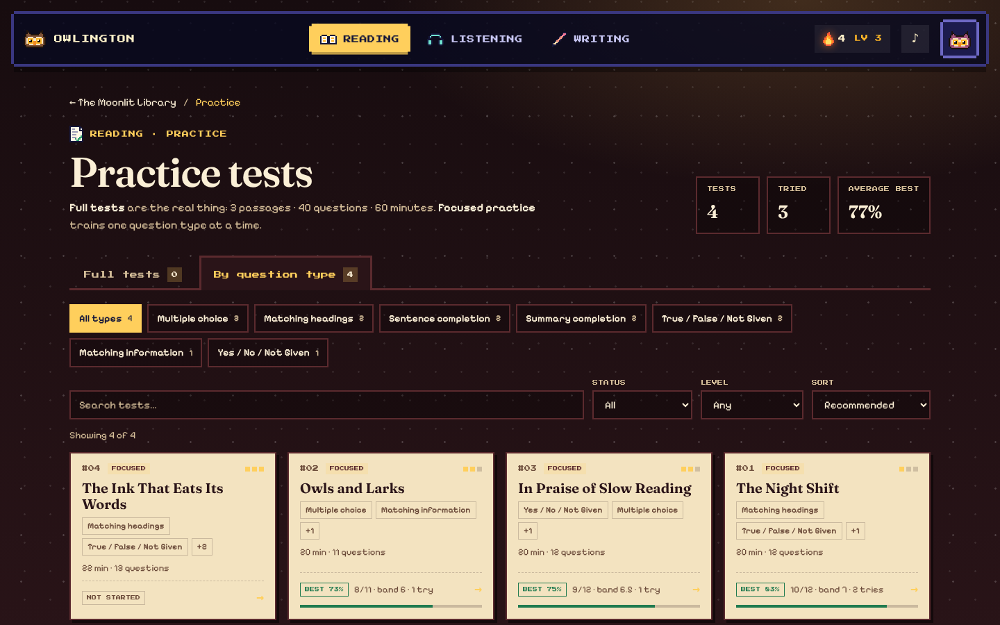
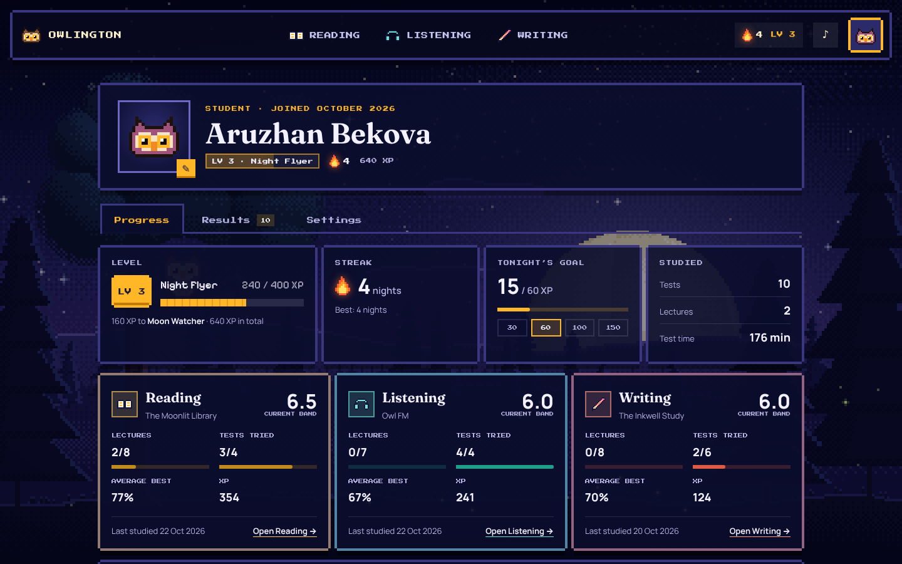
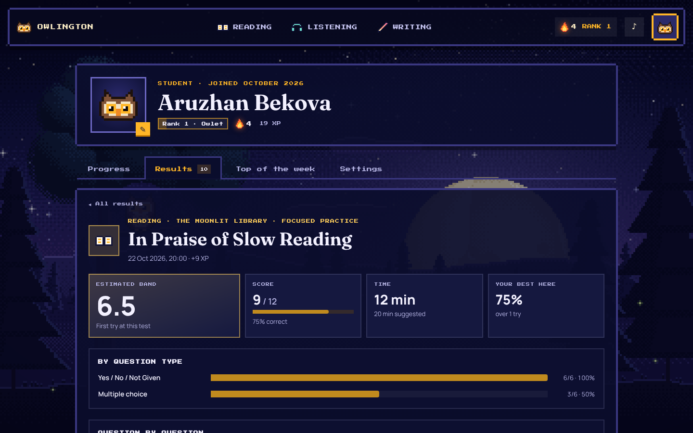
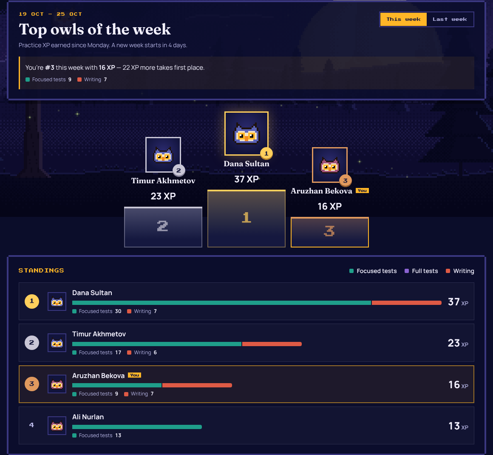

# 🦉 Owlington

**IELTS prep for night owls.** Owlington is a cosy, moonlit place to prepare for the three IELTS skills,
**Reading**, **Listening** and **Writing**, with video lectures from real teachers and a pixel-art forest that
makes studying feel like an adventure.


## What's built so far

| Area | Status |
| --- | --- |
| **Landing page**: night-sky hero, interactive owl mascot (eyes follow your cursor, it blinks and hoots when clicked), skill cards, how-it-works, student/teacher “doors” with a live preview of the student world | ✅ |
| **Sign up / log in**: choose **Student** or **Teacher** at registration; each role gets its own dashboard | ✅ (temporary, browser-only auth, see below) |
| **Student dashboard**: full-screen animated pixel night (see below) with a HUD on top: `READING` · `LISTENING` · `WRITING` tabs and the student's avatar on the right | ✅ |
| **Reading, Listening and Writing sections**: each its own animated world. The section home shows an overview and two doors, **Lectures** and **Practice**, each on its own page (see below) | ✅ (lectures play as animated notes until videos are uploaded) |
| **Practice catalogue**: built for 20–30 tests per section, split into **Full tests** and **By question type**, with type filters, search, status/level filters and sorting | ✅ (the test content is still being written) |
| **Student profile** (opened from the avatar): progress, every result in one shared design, avatar and account settings | ✅ |
| **Progress & motivation**: XP, 7 ranks, 8 achievements, a daily goal, streaks, a weekly leaderboard, band history, celebrations, 8-bit sounds | ✅ (stored in the browser for now) |
| **Teacher dashboard** | 🟡 placeholder |


### The pixel night

The student dashboard background is drawn live on a `<canvas>` at a low “virtual” resolution and scaled up with
`image-rendering: pixelated`, so every pixel is a crisp square. All of it is generated from a fixed seed in
[`src/scene/NightSceneEngine.ts`](src/scene/NightSceneEngine.ts):

- a big, deep sky full of **twinkling stars** and a dithered **Milky Way**
- **falling stars** streaking across every few seconds
- a **huge moon rising on the horizon** with craters, maria and a glowing halo
- layered hills, drifting clouds and valley mist
- **swaying pine trees** and a big moonlit oak that drops the odd leaf
- **the owl** perched on the oak's branch: it blinks, looks around, and hoots (with music notes) when you click it.
  On the dashboard it also talks to you in an RPG-style dialog box with IELTS tips.
- fireflies drifting over the meadow

It pauses when it's off-screen and respects `prefers-reduced-motion`.

## The three sections

All three share one goal — **video lectures → practice tests → progress you can see** — but each is its own world
with its own metaphor, layout and motion. Every section has the same three pages:

- **Home** (`/student/<section>`): the world's hero, a few headline numbers and two doors, *Lectures* and *Practice*.
- **Lectures** (`/student/<section>/lectures`): the bookshelf, the tape rack or the corkboard of letters.
- **Practice** (`/student/<section>/practice`): the shared practice catalogue, themed per section. Tests are tabbed
  into **Full tests** (a complete IELTS paper section) and **By question type** (focused drills, e.g. only
  Yes / No / Not Given), with filters by type, status and level, search and sorting. Filters live in the URL.



| | Concept | Lectures | Practice |
| --- | --- | --- | --- |
| **Reading** | *The Moonlit Library*: a candlelit library tower with moonbeams and drifting dust | 8 lectures as books on a shelf; a bookmark ribbon shows how far you've read | **15 full tests** (three passages, 40 questions, 60 minutes, passage tabs) and **27 focused tests** by question type — every IELTS Reading task: T/F/NG, Y/N/NG, headings, matching information / features / sentence endings, multiple choice (one and two answers), summary, note, table and flow-chart completion, short answers. Passage beside questions, highlighting, a candle timer, a question navigator, review with "show in passage" and a "second look" retry mode |
| **Listening** | *Owl FM*: a rooftop radio station under the aurora | 7 lectures as cassette tapes; the tape winds from reel to reel as you watch | **15 full tests** (four parts, 40 questions) and **21 focused tests** by question type: form, note, table, flow-chart and sentence completion, spelling & numbers, multiple choice (one and two answers), matching and map/plan labelling. Studio recordings (ElevenLabs, real British and Australian voices) where recorded, otherwise the browser's speech voices; exam mode plays once; a transcript review highlights answers and distractors |
| **Writing** | *The Inkwell Study*: a lantern-lit desk by a rainy window | 8 lectures as sealed letters pinned to a board | **15 full tests** (Task 1 + Task 2 against one 60-minute clock, switching freely between the papers; Task 2 counts double in the band) and **24 focused prompts** by type: line, bar, pie, table, mixed charts, process, maps, a GT letter; opinion, discussion, advantages–disadvantages, problem–solution and two-part essays. Writing studio: ink-clock timer, live word goal, linking-word and sentence-rhythm panels, autosave, an automatic 10-point checklist, self-assessment on the four official criteria and annotated model answers |

<p>
  
  
  
</p>

### Lectures and videos

Lectures live in each section's `content.ts` (`src/pages/student/<section>/content.ts`). Until a teacher records the
video, the player shows an **animated notes preview**: the pixel owl presents every key point of every chapter like
slides, with a timeline, chapters, speed control and resume. To attach a real video, set `video` on the lecture:

```ts
video: { kind: 'file', src: '/videos/skimming.mp4', poster: '/videos/skimming.jpg' }
// or
video: { kind: 'youtube', id: 'VIDEO_ID' }
```

Lectures **can't be skipped forward**, only rewound: the timeline, chapter list and "next" button only go as far as
the student has already watched. This works for the notes preview, uploaded files and YouTube videos.

### Adding practice tests

Each section's `content.ts` lists its practice tests (`practiceSets`). Two fields drive the catalogue:

```ts
format: 'full' | 'focused' // which tab the test sits in (default: 'focused')
tags: ['Yes / No / Not Given'] // question types for the filter chips (default: `kinds`)
```

The questions themselves live in one module per test, loaded only when the test is opened, and are written with small
builders that number questions and keep evidence next to every answer:

| Section | Test modules | Builders | Check everything |
| --- | --- | --- | --- |
| Reading | `reading/tests/<id>.ts` | `reading/build.ts` (`tfng`, `headings`, `summary`, `table`, `passage`, `test`…) | `node scripts/check-reading.mjs [ids]` |
| Listening | `listening/tests/<id>.ts` (+ `<id>.audio.json` when recorded) | `listening/build.ts` (`form`, `notes`, `mcq`, `choose2`, `matching`, `map`, `part`, `test`) | `node scripts/check-listening.mjs [ids]` |
| Writing | `writing/tasks/<id>.ts`, full tests in `writing/tests/<id>.ts` | `writing/build.ts` (`task1`, `task2`, `fullTest`) | `node scripts/check-writing.mjs [ids]` |

The checkers verify that every answer is supported by quoted evidence in the passage or script, word limits, question
numbering, map labels and chart data, and (Writing) that each model answer passes its own 10-point checklist.

**Recording Listening tests.** Scripts are voiced with ElevenLabs (one voice per speaker; the announcer is the same
throughout). `scripts/audio-plan.mjs <id> <dir>` splits a test into one chunk per speaker, `scripts/audio-fetch.mjs`
downloads the finished takes and `scripts/audio-build.mjs <id> <dir>` cuts them at the pauses, assembles
`public/audio/listening/<id>.mp3` and writes the line timings to `tests/<id>.audio.json`. A test without a recording
falls back to the browser's voices. A full test needs about 15–17k ElevenLabs credits.

All test content is original: the Cambridge IELTS Academic books were used only as a guide to format and question types.

### Progress & motivation

[`src/learn/`](src/learn) holds the shared learning layer every section uses:

- **Practice XP**: 1 XP for every correct answer in Reading and Listening (a 10-question focused test is worth up
  to 10 XP, a 40-question full test up to 40), and the band for Writing (band 6 → 6 XP; half bands round up).
  Finishing a lecture gives 5 XP. The rules live in `XP_RULES` and `attemptXp()` in
  [`src/learn/progress.ts`](src/learn/progress.ts).
- **Ranks** (shown as `RANK n` in the top bar), in `RANKS` in `progress.ts`:

  | Rank | XP | |
  | --- | --- | --- |
  | 1. Fledgling | 0 | A student taking the first steps |
  | 2. Owlet | 1,000 | A student soaking up knowledge |
  | 3. Night Watcher | 1,200 | An adept learning what is hidden |
  | 4. Feather Scholar | 1,400 | A master who has gathered wisdom |
  | 5. Silver Wing | 1,600 | Keeper of the ancient scrolls |
  | 6. Arch-Owl | 1,800 | The high mage — or the dean |
  | 7. The Silent Glide | 2,500 | A legend who has reached perfect enlightenment |

- **Tonight's goal** is 30 XP a day; anything beyond it is a bonus. **Daily streaks** show as the flame in the top bar.
- **Achievements** (`ACHIEVEMENTS` in `progress.ts`), each unlocked once for the XP shown. "Different tests" means
  retakes of the same test count once.

  | Section | Achievement | How to unlock | XP |
  | --- | --- | --- | --- |
  | Listening | Sharp-Eared Owl | Complete 10 different full tests | 100 |
  | Listening | The Owl Codebreaker | All answers right in 3 different spelling tasks | 20 |
  | Listening | Echoing Owl | Band 8.5–9.0 on a full test | 200 |
  | Reading | Skimming Owl | A skimming & scanning focused test with no mistakes | 30 |
  | Reading | True-False-Owl | Complete a True / False / Not Given focused test | 10 |
  | Reading | Bookworm Owl | Complete 10 different full tests | 100 |
  | Writing | Graph-Watching Owl | Band 8.5–9.0 on a Task 1 | 50 |
  | Writing | Essay-Weaving Owl | Band 7.5+ on a full test | 100 |

  A focused test counts for a question type when that type is its **only** tag (`tags`, or `kinds` when there are
  no tags): `'Spelling'` for spelling tasks, a tag containing "skim" (e.g. `'Skimming & scanning'`),
  `'True / False / Not Given'`, or `'Task 1 · …'` for Writing Task 1.
- **Lecture progress** with resume, and best scores per practice test.
- A **sound toggle** in the top bar for the 8-bit effects.

### The student profile

`/student/profile` gathers everything that used to be spread over the sections:

- **Progress**: rank and XP, streak, tonight's goal, a card per skill with its current band, a
  **band-over-time chart** (one line per section, with hover, keyboard and table views), a 12-week **study-nights**
  calendar, the ladder of ranks and the achievements by section, with progress towards each.
- **Results**: every test from every section in **one design**: the estimated band up front, the raw score, a strip
  of right/wrong squares, and the change since the last try. Opening a result shows the breakdown by question type
  (or by criterion for Writing) and every answer next to the correct one. Each section's results screen links here.
- **Top of the week**: the students who earned the most practice XP this week (Monday to Sunday): a podium for the top
  three, then the standings with each student's XP split into focused tests, full tests and Writing, plus last week's
  final table. Until the backend exists it ranks the students whose accounts are in this browser
  ([`src/learn/leaderboard.ts`](src/learn/leaderboard.ts) is the one place to switch to an API).
- **Settings**: pick one of eight owlet feather colours or upload a photo, change name, email or password, sounds,
  log out.

<p>
  
  
</p>



## Tech stack

- [React 19](https://react.dev) + [TypeScript](https://www.typescriptlang.org) + [Vite](https://vite.dev)
- [React Router](https://reactrouter.com) for pages and role-based route guards
- Plain CSS (one stylesheet per page/component) with design tokens in [`src/index.css`](src/index.css)
- Self-hosted fonts via Fontsource: **Fraunces** (display), **Manrope** (body), **Press Start 2P** and
  **Pixelify Sans** (pixel UI)
- No image assets: the owl mascot is hand-written SVG, and all pixel art is defined as text sprites in
  [`src/scene/sprites.ts`](src/scene/sprites.ts)

## Getting started

Requires **Node.js 20.19+** (or 22.12+).

```bash
npm install
npm run dev        # http://localhost:5173
```

| Script | What it does |
| --- | --- |
| `npm run dev` | Start the dev server with hot reload |
| `npm run build` | Type-check and build for production into `dist/` |
| `npm run preview` | Serve the production build locally |
| `npm run typecheck` | Type-check only |
| `npm run lint` | Lint with oxlint |

Try it: open the site → **Get started** → pick **Student** → you land in the forest. Click the owl!

## Project structure

```
src/
├── App.tsx                  # routes
├── index.css                # design tokens, buttons, pixel panels
├── auth/                    # AuthProvider, useAuth(), <RequireRole>, temporary mock API
├── learn/                   # shared learning layer: progress store + useProgress(), lecture player,
│                            #   section doors, practice catalogue, unified results (results/),
│                            #   progress widgets, achievement toasts, confetti, sound effects, ScrollLink
├── components/
│   ├── NightScene.tsx       # React wrapper around the canvas engine
│   ├── OwlMascot.tsx        # the vector owl from the landing page
│   ├── PixelSprite.tsx      # renders text sprites as crisp SVG
│   └── Avatar.tsx           # an owlet in the student's feathers, or their photo
├── data/sections.ts         # Reading / Listening / Writing: copy, colours, real test format
├── scene/
│   ├── NightSceneEngine.ts  # the procedural, animated pixel night
│   ├── sprites.ts           # owl + icon pixel art
│   └── random.ts            # seeded RNG and value noise
└── pages/
    ├── landing/             # marketing page
    ├── auth/                # register (student/teacher) + login
    ├── student/             # layout + HUD, owl dialog
    │   ├── profile/         # progress, results and settings tabs, band chart, study calendar
    │   ├── reading/         # The Moonlit Library (content.ts, practice-data.ts, hub, lecture, practice)
    │   ├── listening/       # Owl FM (content.ts, practice-data.ts, speech.ts, hub, lecture, practice)
    │   └── writing/         # The Inkwell Study (content.ts, prompts.ts, analysis.ts, hub, lecture, studio)
    ├── teacher/             # teacher dashboard (placeholder)
    └── NotFound.tsx
```

### Routes

| Path | Who | Page |
| --- | --- | --- |
| `/` | everyone | Landing |
| `/register?role=student\|teacher` | everyone | Sign up |
| `/login` | everyone | Log in |
| `/student` | students | Dashboard (pixel night) |
| `/student/reading`, `/listening`, `/writing` | students | Section home: overview + Lectures / Practice |
| `/student/<section>/lectures` | students | All lectures of a section |
| `/student/<section>/lecture/:lectureId` | students | Lecture player |
| `/student/<section>/practice` | students | Practice catalogue (`?tab=full\|focused`, filters in the URL) |
| `/student/<section>/practice/:practiceId` | students | Practice test |
| `/student/profile` | students | Profile (`?tab=progress\|results\|top\|settings`) |
| `/teacher` | teachers | Teacher dashboard (placeholder) |

## ⚠️ About authentication (temporary)

There is **no backend yet**. Accounts are stored in the browser's `localStorage` by
[`src/auth/mockAuthApi.ts`](src/auth/mockAuthApi.ts) so the product can be clicked through end-to-end. This is
**not secure** and every browser has its own separate set of accounts. When the backend exists, replace the
functions in that one file with API calls. The rest of the app only talks to `AuthProvider`.

Learning progress works the same way: [`src/learn/progress.ts`](src/learn/progress.ts) keeps it in `localStorage`
per student, behind the `useProgress()` hook, so it can move to the backend later without touching the pages.

## Deploying

### GitHub Pages

The `Deploy to GitHub Pages` workflow builds and publishes changes pushed to `main`.
In repository **Settings → Pages → Build and deployment**, choose **GitHub Actions**
as the source. Run the workflow manually from **Actions** if it has not deployed yet.
The published address is `https://nurmukasan.github.io/owlington/`.

Pages builds use `GITHUB_PAGES=true npm run build`, setting the asset base to
`/owlington/` and using hash routes so refreshing a page works on static hosting.
Regular local development continues to use normal browser routes.

It's a static single-page app: deploy the `dist/` folder anywhere (Vercel, Netlify, Cloudflare Pages, GitHub
Pages…). Configure the host to serve `index.html` for unknown paths so routes like `/student` work on refresh.

## Roadmap

- [x] Reading, Listening and Writing sections with lectures, practice tests and progress tracking
- [x] Student profile: progress, unified results, avatar and account settings
- [x] 15 full tests per section plus focused tests by question type (Reading 42, Listening 36, Writing 39)
- [ ] Record the remaining Listening tests with ElevenLabs (Full Tests 1–2 are recorded)
- [ ] Record and upload the real video lectures
- [ ] Design the teacher dashboard (upload lectures, organise courses, see students, review essays)
- [ ] Real backend: accounts, sessions, progress, video storage
- [ ] Writing bands checked by the DeepSeek API instead of the student's self-assessment
- [ ] Teacher feedback on writing
